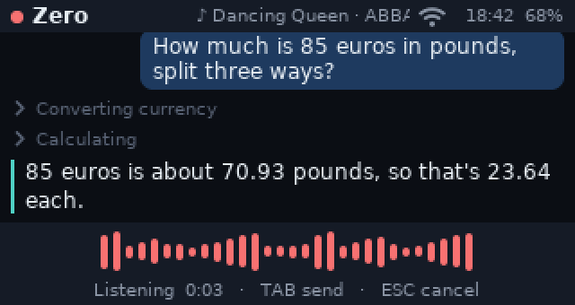
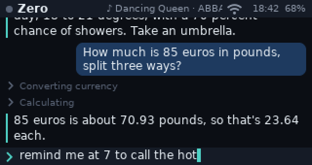
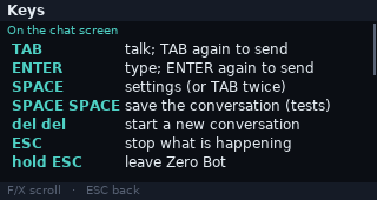
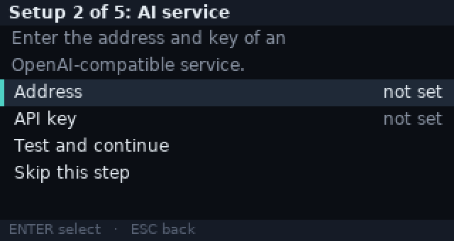

# Zero Bot

A pocket voice assistant for the [M5Stack CardputerZero](https://docs.m5stack.com/en/CardputerZero).
Press a key, talk, and it answers out loud. It can look through the camera, keep your
calendar, run timers, set reminders, play your music, work a TV, and look things up, which makes
it a handy travel companion.

It is a native C++ app built on LVGL. It talks to any OpenAI-compatible service that offers
chat with tool calling, speech-to-text and text-to-speech; nothing about a particular provider
is built in.

| | | |
|---|---|---|
|  |  |  |
|  |  |  |

## What it can do

| Ask for | Example |
|---|---|
| Sums | "What's seventeen and a half percent of 2,340?" |
| Dates | "How many days until Christmas?", "What day is the 3rd of March?" |
| Python, in a sandbox | "Sort these names alphabetically…", longer calculations |
| What the camera sees | "What am I looking at?", "Translate this menu." |
| Calendar | "Put dinner with Marta in my calendar for Friday at eight." |
| Birthdays and repeating events | "Mum's birthday is the 14th of March.", "Bin collection every Tuesday at seven.", "How old will Dad be this year?" |
| Timers | "The food needs to come out of the oven in 5 minutes.", "I want to study for an hour, set a timer.", "How long is left?", "Cancel the study timer." |
| Reminders | "Remind me at 7 tomorrow to call the hotel." |
| Things to remember | "Remember that I'm allergic to shellfish." |
| Web search | "What time does the Louvre open on Sundays?" |
| Weather | "Do I need an umbrella in Lisbon tomorrow?" |
| Currency | "How much is 85 euros in pounds, split three ways?" |
| Share prices | "How's the Apple share price doing?" |
| Time zones | "What time is it in Tokyo?", "I've just landed in New York." |
| Your music | "Play a random rock song.", "Play something by ABBA." |
| Internet radio, from your own list of stations | "Play Radio 2.", "Put on the jazz station.", "Stop the radio." |
| A TV | "Turn on the TV.", "Volume up a bit.", "Channel down." |
| Smart-home devices on your own network | "Turn on the bed heater.", "Is the kettle on?", "Switch everything off." |
| The device itself | "Turn your volume down to 40 percent." |

Weather, currency and share prices use free public services that need no account. Web search
needs a [Tavily](https://tavily.com) key.

## Using it

| Key | What it does |
|---|---|
| **TAB** | Start talking. Press **TAB** again when you have finished. The answer is spoken and shown on the screen; if something goes wrong (the AI service fails, or no words were heard), a short sentence says so and the reason is shown. Pressed while an answer is being spoken, it stops the answer and listens; an answer that is only shown (to a typed message, or with spoken replies off) is not stopped. |
| **SPACE** | Open settings (**TAB** twice quickly does the same). **SPACE** or **TAB** closes them again. |
| **SPACE** twice quickly | Save this conversation, to help diagnose and improve the assistant (see [Diagnostics (temporary)](#diagnostics-temporary)). Because of this, one **SPACE** opens settings a moment later, once no second press has come (at once if another key follows it). |
| **ENTER** | Start typing a message; **ENTER** again sends it. A typed message is answered on the screen only, without speaking (anything you say while it is worked on makes the answer spoken too). |
| **del** twice quickly | Start a new conversation: what was said so far is forgotten. Calendar, timers, reminders and saved memories are kept. |
| **ESC** | Cancel what is happening: recording, typing, a running request, music. |
| Hold **ESC** | Leave the app and return to the launcher. |
| **F** / **X** (or **fn**+**F** / **fn**+**X**) | Scroll the conversation up and down. While typing, use **fn**+**F** / **fn**+**X**. |
| **H** | Show every key and what it does (also in settings, and under *Settings → Keys*). |
| **fn**+**S** / **fn**+**D** | Volume down / up. **fn**+**A** mutes and unmutes. On the conversation screen, until **ENTER** starts typing, plain **S** / **D** and **A** do the same. |
| **fn**+**U** / **fn**+**I** | Screen brightness down / up. |
| Any key, screen off | Turns the screen back on, and does nothing else. |
| **fn**+**Q** / **fn**+**W** / **fn**+**E** | Music: pause or resume / previous track / next track. With a radio station on: pause or resume / previous station in your list / next station. On the conversation screen, until **ENTER** starts typing, plain **W** / **E** do the same as **fn**+**W** / **fn**+**E**. |

The bottom of the screen names the keys you need most; **H** lists the rest.



You do not have to wait for it to finish:

- **While it is still working** (thinking, or using a tool), anything you say or type is added
  to the same request, so you can correct or refine it before it answers.
- **While it is speaking**, typing leaves the speech playing; pressing **TAB** stops it at once
  and starts listening. The answer to a typed message (and every answer, with spoken replies
  off) is only shown, so **TAB** starts listening and leaves that answer as it is.

The dot in the top-left corner shows what it is doing: red while the microphone is live, amber
while it is working, teal while it is answering. The screen dims after 45 seconds without use
and goes off after five minutes (see *Screen off after* below); any key wakes it.

### Timers

Ask for a timer in your own words, and give it a name if you like: "the food needs to come out
of the oven in 5 minutes", "I want to study for an hour, set a timer". Up to ten can run at
once. The one that ends soonest counts down in the status bar, followed by "+2" when two more
are running (the title of any music playing is shortened to make room), and everything else
keeps working meanwhile: talking, typing, settings, music, the breathing exercise.

- **When one ends** the screen lights up with a banner naming it, an alarm rings for up to a
  minute, music pauses, and the name is spoken once (if spoken replies are on): the alarm holds
  back for a few seconds at most while the assistant speaks, then rings on. If you are talking
  to the assistant at that moment, it waits until you have finished. A timer that ends while
  another is ringing joins the banner and starts the alarm again. **Any key** stops it; **TAB**
  stops it and starts listening, so "give it five more minutes" is one press away.
- **Muted** with **fn**+**A**, the alarm stays silent: the banner is all you get. A key press
  first dismisses the banner, so press **fn**+**A** after that to unmute.
- **Ask** "how long is left?", "add ten minutes to the pasta", "cancel the study timer". With
  several running, it asks which one you mean. *Settings → Your data → Reminders and timers*
  lists them with their time left, to cancel one or all.
- **Timers carry on** if you leave the app. One that ended while it was closed is shown as
  missed when you open it again, and still rings if it ended less than two minutes before.
  While the app is open a timer counts the time that passes, even if the clock is set meanwhile
  (as it can be when the device first goes online after starting).

 

## Install

### 1. Install the package

Download `zero-bot_<version>_arm64.deb` from the Releases page, copy it to the CardputerZero
(over SSH, ADB or the microSD card) and install it on the device:

```sh
sudo apt install ./zero-bot_0.4.8_arm64.deb
```

"Zero Bot" then appears in the launcher within a few seconds. To build the package yourself
instead, see [Building](#building).

The package also puts Zero, the app's 8-bit robot, on the picture the launcher shows when the device
wakes from its lock screen, from the next restart of the device. It changes the launcher's picture the
way Debian provides for (a diversion): the launcher's own picture is kept beside it and kept current by
the launcher's updates, and removing Zero Bot (`sudo apt remove zero-bot`) puts it back, again from the
next restart.

### 2. Follow the setup guide

The first time you open Zero Bot it walks you through five short steps: checking the internet
connection, entering the AI service's address and key (with a live test), confirming the models
it found, a few details about you, and optional extras. **ENTER** chooses (**SPACE** does not
close the guide), **ESC** steps back, and you can skip it and run it again later from *Settings →
About → Run the setup guide again*.

 

### 3. What the AI service needs

The app needs the address and key of an OpenAI-compatible service that provides:

- `POST /chat/completions` with streaming and tool calling (a vision-capable model is needed
  for the camera),
- `POST /audio/transcriptions` (speech-to-text),
- `POST /audio/speech` (text-to-speech, returning raw PCM or WAV),
- `GET /models`.

Enter the *Address* (ending in `/v1`) and *API key* in the setup guide, or later under *AI
service* in settings. If typing a long key on the small keyboard is a chore, you can instead
create `~/.config/zero-bot/settings.json` on the device over SSH or ADB before first launch:

```json
{ "api_base": "https://your-service/v1", "api_key": "your-key" }
```

The first time it connects, the app picks a language model, a speech-to-text and a text-to-speech
model from the service's list, by what the list labels each model for (its `mode`): the language
model only from those labelled `chat`, never an unlabelled one (that could be a model for
something else, such as embeddings). A service that labels none of its models gets nothing picked:
choose each model under *Assistant* in settings, which lists the models labelled for that use or,
where there are none, the unlabelled ones. You can change every model there. The list is read once
per service (address and key); while the service cannot be reached, the app asks again after a
while, less often each time, and at once when the connection comes back.

### 4. Optional extras

- **Web search:** add a Tavily key under *AI service → Web search key*.
- **Music:** copy your music into `~/Music` on the device, then choose *Music library* in
  settings to rescan. MP3 tags (title, artist, album, genre) are read automatically.
- **Radio:** list the stations you listen to in `~/.config/zero-bot/radio.json` (see
  [Radio](#radio) below). The app comes with none.
- **Home city and country, your name, time zone:** under *Device* in settings, or just tell the
  assistant. The country tells apart cities that share a name (London, Canada).
- **Internet through your phone:** pair the phone with the device once in the system Bluetooth
  settings and switch on *Bluetooth tethering* in the phone's hotspot settings. When there is no
  Wi-Fi, Zero Bot then connects through the phone by itself the next time you ask something.
  *Device → Internet via phone* connects or disconnects by hand, and *Use phone when offline*
  turns the automatic behaviour off.

## Settings

Press **SPACE** (or **TAB** twice). The first page lists the sections below and *Keys*; **ENTER**
opens one. Move with **fn**+**F**/**X** (or plain **F**/**X**), change values with **Z**/**C**
(left/right), select with **ENTER**, go back with **ESC** (or **del**). **SPACE** or **TAB** closes
settings from any page.

| Section | What is there |
|---|---|
| Assistant | Language, vision, speech-to-text and text-to-speech models; voice; spoken replies on/off; fast replies; the assistant's name |
| Device | Volume, brightness, screen off after, microphone gain, time zone, internet via phone, use phone when offline, microphone, flip camera image, home city and country, your name, date order, units |
| Your data | Calendar (edit, add, delete, delete all), reminders and timers (cancel one or all), memory (edit, add, delete, forget everything), TV remote, smart home (devices by room, setting up, the Tapo account), music library, radio stations (what was read from your list, play one to try it), saved conversations (how many, delete them all; see [Diagnostics (temporary)](#diagnostics-temporary)), start a new conversation |
| AI service | Address, API key, web search key, compress audio |
| About | Status and connection test, the setup guide again, exit to launcher |
| Keys | Every key and what it does (as **H** shows them) |

*Compress audio* (under *AI service*, on by default) sends your speech as MP3 and fetches replies
as Opus, roughly a tenth and a fifth of the uncompressed size. In testing it produced the same
transcribed words as uncompressed audio, and on a Bluetooth-tethered phone it cut the time to
send five seconds of speech from about 7 seconds to under 2. If a service does not accept those
formats the app falls back to uncompressed audio by itself.

*Fast replies* (on by default) asks the model to skip its private reasoning step, and makes up
for it by double-checking any reply that did not use a tool before it is spoken. On the bundled
test set this passed 60 of 61 requests at a median of about 3 seconds each on Wi-Fi; with it off
the model reasons on every step, which is a second or two slower.

*Dates* (under *Device*, day first by default) decides how a date given in numbers is read: with
*Day first*, "3/4" is 3 April; with *Month first* it is March 4. The app works this out itself
before the request reaches the model, fills in the year (the next time that date comes round),
and uses the same order when it shows dates and when you type one into the calendar editor. Dates
are always shown and spoken with the month as a word, so a misheard date is easy to catch.

*Screen off after* (under *Device*: never, 1, 2, 5, 10 or 15 minutes; 5 by default) switches the
screen off when the device has not been used for that long, against burn-in: it is drawn black,
nothing more is drawn, and the backlight goes off. Music and the radio keep playing. Any key turns
it back on, exactly as it was (the chat, a settings page, text being typed), and does nothing else,
so a stray press is harmless (**fn** or shift tapped on its own wakes it too). It stays on while
you are talking, while a request is worked on or its answer spoken, during a breathing exercise
and while a timer's alarm rings; an alarm or a reminder turns it on at once. If the app should
crash while the screen is off or dimmed, the backlight is put back at the brightness you set.

### Calendar

Events can be one-off or repeat every day, week, month or year, and can be timed or all-day.
Ask for them in plain words, or use *Your data → Calendar* to add and edit them by hand (*All
day* and *Repeats* are rows on the event page).

- **Birthdays and anniversaries** are saved as all-day events that repeat every year, and alert
  at 09:00 on the day unless you change the *Alert* row. If you give the year ("born in 1960"),
  the assistant can tell you the age, and the alert includes it.
- **Finding one:** "when is Dad's birthday?" searches the coming year by name.
- A yearly 29 February falls on the 28th in other years; a monthly 31st on the last day of
  shorter months.
- Changing or deleting a repeating event changes the whole series. One-off events have to be in
  the future when you add them by voice.

  

### TV remote

The remote has built-in codes for Samsung, LG, Sony, Panasonic, Philips, Toshiba and Vizio. Left
on *Any*, it sends each button for every brand in turn, which is usually what you want with a
hotel TV. Point the top edge of the device at the TV. The remote sends the codes of the one brand
in settings, whichever TV it points at; naming another brand ("turn up the Sony") changes that
setting. A TV set up under *Smart home* (a Fire TV) is controlled over the network instead, with
no pointing: its volume, menu keys, apps and power.

For anything else, *Your data → TV remote → Learn a button* records a button from the real
remote. Give it a standard name (`power`, `volume_up`, `mute`, `input`, …) to replace the
built-in code, or any name of your own.

### Radio

Zero Bot plays live internet radio from your own list of stations. It comes with none, and while
the list is empty the assistant is not offered radio at all. Put your stations in
`~/.config/zero-bot/radio.json`:

```json
{
  "stations": [
    {"name": "Harbour FM", "nicknames": ["Harbour"], "url": "https://stream.example.org/harbour.mp3"},
    {"name": "Night Jazz", "nicknames": ["the jazz station"],
     "url": "https://stream.example.org/jazz-128.aac",
     "low_data_url": "https://stream.example.org/jazz-48.aac"}
  ]
}
```

- `name` is what the assistant and the status bar call the station. `nicknames` are other names
  you use for it ("Radio 2" for a longer name); numbers said as words match too ("radio two").
- `url` is the stream itself: an MP3 or AAC stream, an HLS playlist (`.m3u8`), or a `.pls` or
  `.m3u` playlist file that names one. A web page with a player on it is not a stream, and the
  assistant says so.
- `low_data_url` (optional) is used when the internet comes through your phone by Bluetooth or a
  USB cable, where data may cost money. Without one, the assistant mentions that radio uses about
  30 to 70 MB an hour. A phone's Wi-Fi hotspot looks like any other Wi-Fi network to the device,
  so there the main address plays.
- A change to the file is used from the next request; no restart is needed. *Your data → Radio
  stations* shows what the app made of the file (with anything it could not use, and why), and
  plays a station so you can try it (one that will not play says why).
- **Finding addresses:** [radio-browser.info](https://www.radio-browser.info) is a free directory
  of stations' stream addresses: search for the station and copy its stream address. Where a
  station offers several qualities, 96 to 128 kbit/s suits the speaker and 48 kbit/s the phone.
  For HLS, use a playlist of one quality, not the list of all of them, and prefer a live-only one:
  the player reads the playlist again every few seconds, and a long one with hours of rewind can
  cost more data than the sound.
- **Abroad:** many stations play only in their home country, and some take programmes off their
  worldwide stream for rights reasons (sport especially). When a station refuses to play, the
  assistant says it may not be available in this country. Broadcasters that have a worldwide
  stream of their own are the better choice for a traveller.

Say "play Harbour FM" or "put on the jazz station"; "stop the radio" or **ESC** stops it. The
radio pauses while you talk and while the assistant answers, then rejoins the live broadcast.
**fn**+**Q** pauses and resumes, **fn**+**W** and **fn**+**E** move to the previous and next
station in your list, and the status bar shows the station's name. If a stream stops and cannot
be joined again (the station is off the air, the Wi-Fi has gone), a note on the screen says so. A
stream does not say what is on; with web search, the assistant can look the schedule up.

### Smart home

Zero Bot can switch smart-home devices on your own Wi-Fi or wired network, talking to each
device directly: nothing goes through the makers' cloud services. Supported so far:

- **TP-Link Tapo** smart plugs and power strips (tested against simulated P110 plugs and a P304M
  strip; each socket of a strip is switched on its own). Every plug of your Tapo account accepts
  the same login, so after logging in Zero Bot asks the plug at the saved address which plug it
  is: when the router has given that address to another of your plugs, nothing is switched.
- **Accessories that work with Apple HomeKit**, over Wi-Fi or Ethernet: one driver for many
  brands, such as hubs and bridges (Hive, tado, Netatmo, ecobee, Aqara, IKEA) and Wi-Fi plugs,
  lights and thermostats that carry a HomeKit setup code. Zero Bot pairs with the accessory
  itself on your network, using the 8-digit setup code from its label, box or maker's app (or the
  text of its QR code); no Apple device, Apple account or internet connection is involved. It can
  switch lights, plugs and switches, dim and colour lights, set heating targets and modes, move
  blinds, set fan speeds, and read temperature, humidity, motion and door or window sensors.
  Locks, garage doors, alarms, cameras, doorbells, valves and taps are never offered, even when a
  bridge has them; televisions, speakers and set-top boxes are left to their own drivers. An
  accessory has only one owner controller, so it is paired either with Zero Bot or with Apple Home,
  not both (*Unpair* in Zero Bot hands it back; do that while the accessory is on and on this
  network, or Zero Bot keeps the pairing and says so). Accessories that use HomeKit only over
  Bluetooth or Thread are not supported. If the handheld is lost while paired, reset the
  accessory's HomeKit pairing from its maker's app. Tested so far only against a simulated
  accessory.
- **Amazon Fire TV** (Fire OS televisions, sticks and cubes; the newer Vega OS sticks are
  untested), worked the way Amazon's Fire TV phone app does: it can move around the menus (up,
  down, left, right, OK, back, home, menu), play and pause, rewind and fast-forward, open an
  installed app by name ("put Netflix on"), switch the screen off and wake the TV again. Switching
  it on counts as done once the TV takes the wake-up request; the TV then needs a few seconds
  before it takes other commands, and Zero Bot says it is still starting up if asked sooner.
  Switching it off sends the wake-up request only when the TV has answered, or been switched on
  by Zero Bot, in the last minute: that request is what brings a TV on from deep standby. So a TV
  left on long enough for its remote-control service to doze off (Fire TVs do that after some
  minutes unused) is reported as off already, and needs its own remote, or another command
  first, to be switched off.
  Volume and mute work only on models that report network volume control (many sticks do not);
  for those, and for channels, inputs and number keys, use the infrared remote. A Fire TV in deep
  standby can be woken over the network only if Zero Bot heard its wake-up address while it was
  on, and then takes about 7 seconds to come on; otherwise switching it on needs the infrared
  remote. Zero Bot remembers the TV's security key from pairing; if the TV later presents a new one
  (a Fire TV can change it, for example after a restart), Zero Bot checks once that the TV still
  accepts the pairing and then carries on with the new key; if it does not, it asks you to pair
  again. Amazon does not document this interface, so a Fire TV software update could change it.
  Tested so far only against a simulated TV.
- **Philips Hue**, through the Hue Bridge (the square bridge and the Hue Bridge Pro; the first,
  round bridge is not supported), over the bridge's own local interface: switch, dim and colour
  lights and set shades of white, switch Hue smart plugs, start scenes, and read the motion and
  temperature of Hue motion sensors. Rooms and zones come from the Hue app, and a whole room or
  zone is switched with one command to the bridge whenever the request covers exactly its lights.
  Hue cameras, doorbells, chimes and contact sensors are never offered, nor are scenes that use
  them, nor scenes that switch on a Hue smart plug: a plug is switched on only when you name it,
  so that its *Ask before switching on* question is never skipped. A scene is read from the
  bridge again just before it starts, so one changed in the Hue app since the list was read, or
  one that holds a light set to *Ask before switching on* or not to be used by the assistant, is
  not started, and Zero Bot says why. Zero Bot remembers the
  bridge's security key from pairing and sends nothing to a device that presents another; a
  bridge software update can change the key, and Zero Bot then asks you to press the bridge's
  button again to confirm. *Unpair* makes Zero Bot forget the bridge's key, but the bridge itself
  goes on accepting that key until it is removed in the Hue app; do that too if the handheld is
  lost. Tested so far only against a simulated bridge.
- **TP-Link Kasa** plugs, power strips, wall switches, dimmers, bulbs and light strips that use
  Kasa's older local protocol (models such as HS100, HS103, HS110, KP115, HS200, HS220, HS300,
  KP303, KL130 and KL430). They need no account and no setting up: Zero Bot switches them on and
  off (each socket of a strip on its own), dims dimmers and bulbs, sets a bulb's colour or shade of
  white, and reads the power and today's energy on models that measure it. TP-Link has been moving
  Kasa devices to the newer login that Tapo plugs use with firmware updates; Zero Bot cannot use
  that login with these devices, and says so for one that has moved (the Kasa app still controls
  it). Newer Kasa models made on Tapo's system are listed as Tapo devices (untested). The older
  protocol has no password at all, so before each change Zero Bot asks the device at the saved
  address which device it is: when the router has given that address to another Kasa device,
  nothing is switched and the device is looked for again. TP-Link does not document the protocol.
  Tested so far only against simulated devices.
- **WiZ** lights, plugs and ceiling fans (WiZ Connected, including Philips-branded ones): switch
  them on and off, dim lights and change their shade of white or colour, and read a plug's power
  where it measures it. *Allow local communication* must be on in the WiZ app's settings (it
  is by default). WiZ devices keep no name of their own, so each is listed as "WiZ light" (or plug,
  or fan) with the end of its hardware address: give it the name you will say on its page
  (*Called*). The built-in scenes are not offered. Newer WiZ firmware takes changes only when they
  are signed with your WiZ home's key; such a device asks for it once (see below). WiZ does not
  document this protocol: Zero Bot follows the open-source pywizlight library, which Home Assistant
  uses. Tested so far only against a simulated device.
- **Shelly** relays, plugs, dimmers, colour and white lights, blinds and temperature sensors, of
  the first generation and of the Plus, Pro, Mini and later ones. Each channel is its own thing: a
  Plus 2PM is two switches, or one blind when it is set up for a blind; a relay that the Shelly app
  says feeds lights counts as a light, so "turn off the kitchen" includes it. Zero Bot can switch,
  dim and colour them, open and close blinds and move them to a position (a position between open
  and closed only once the blind has been calibrated in the Shelly app), and read power use,
  temperature and humidity; battery sensors such as the H&T can only be read while they are awake.
  It never starts a calibration or changes any of the device's settings. A relay or blind named
  like a garage door, gate, door, lock, opener, valve, alarm or siren is never offered (a Shelly 1
  is often fitted to a garage door), unless its name says it is a light ("Front door light"); the
  words for garage, door, gate and lock in German, French, Spanish, Italian, Portuguese, Dutch and
  Polish count too. An unnamed relay or blind goes by the device's name, so a Shelly named "Garage
  door" is left out too. Nor is a relay set in the Shelly app to switch itself off within ten
  seconds (that is how a door or gate opener is wired, whatever it is called), nor thermostats, or
  smoke, gas, flood and door sensors. Because any of that can be changed in the Shelly app later,
  Zero Bot reads a relay's or blind's settings again just before each change and does nothing if
  it is now one of those. Before every change, read and pairing it checks that the device at the
  saved address is still the same Shelly (the one whose things it read, and the one that took the
  password), so a password never goes to another device. Tested so far only against simulated
  devices.

Other families are added one driver at a time.

1. On your home network, open *Your data → Smart home → Find devices on this network*. Only do
   this on a network you own: the page before the scan (*Before you scan*) names the network it
   will scan, and the scan is of that network only (if the device joins another network
   meanwhile, nothing is scanned there, and what was heard is not kept). The scan only asks devices
   to identify themselves, the way the makers' apps do; it does not log in to anything or change
   anything.
2. Devices that need it are listed under *To set up*; *Set up…* walks through what the device
   asks for (press a button, accept a prompt, type a code or password). Tapo plugs obey only
   the Tapo account they were set up with, so they ask for its e-mail address and password; once
   typed for one plug, every plug of that account is ready. Only the e-mail and a scrambled form of
   the password are kept on the device, and only one Tapo account: typing another account's
   address replaces it and asks for that account's password before anything is sent. Because a
   plug locks itself after a few wrong passwords, a password a plug has refused is not tried
   again, by any later run either, until you type it again (*Smart home → Tapo account*). A Fire
   TV asks you to turn it on and choose *I have accepted it*; the TV then shows a 4-digit code to
   type, valid for 5 minutes. A code the TV refuses is never sent again: start again and the TV
   shows a new one. A HomeKit accessory asks for its 8-digit setup code (like 123-45-678); a code
   it refuses is not sent again until you type it again, because accessories stop pairing after
   too many wrong codes. A Hue Bridge says "Press the round button on the Hue Bridge, then confirm
   here. Zero Bot keeps trying to connect for 30 seconds."; press it, then choose *I have pressed
   it*. If the bridge later stops accepting Zero Bot (it was removed in the Hue app), nothing more
   is sent to it, by any later run either, until you set it up again with the button. Older Kasa
   devices ask for nothing. A WiZ device on newer firmware asks for the `udp_signing_key` from the
   WiZ app's export of your home for local integration (32 characters, 0 to 9 and a to f). One key
   serves every WiZ device of the home; a key a device refuses is not sent again until you type it
   again. Signed changes carry the time, so just after the handheld starts they wait until its
   clock has been set from the internet. A Shelly asks for nothing unless its owner set a password
   in the Shelly app; then it asks for that password (a first-generation Shelly first asks for its
   login's user name, which is admin unless it was changed). A password a Shelly refuses is not
   sent again, by any later run either, until you type it again, because Shelly devices hold back
   logins after wrong passwords. The password is kept on the handheld, in the same private file as
   the devices. Anything typed here is noted in that file before it is first sent, and the note goes
   once a device has accepted it. So if Zero Bot stops before a device has answered (it was closed,
   or the battery ran out), a Tapo password, WiZ key or Shelly password is not sent again, by any
   later run either, until you type it again: the device then asks for it, saying it never
   confirmed the one typed last. If the file cannot be written (the storage is full), nothing typed
   is sent at all and Zero Bot says why; any other change on these pages that could not be kept
   is reported too (*Not saved*).
3. What each device controls is then listed by room. On its page you can set the name you will
   say (*Called*), a *Room* (guessed from the name where it starts with one, such as "Bedroom
   lamp"), whether the *Assistant may use it*, and *Ask before switching on*. That last one is on
   by default for a plug whose name suggests heat (heater, kettle, iron, …), and is switched on
   when you give a plug such a name under *Called*: the assistant then
   asks "Turn on Bed heater?" and switches it only if your very next words are a plain yes ("yes",
   "go ahead", "yes please"). Anything else, including a new request or "leave it off", counts as
   no. Turn it off for something you use every day. A device a scan finds again in another way
   after it was set up here the first way (a Kasa plug once set up here as a HomeKit accessory) is
   added as a second entry that the assistant does not use until you turn *Assistant may use it*
   on for it, so that what you set for the first entry is not bypassed through the second. (One
   that was only listed the first way, never set up or switched off, is used at once.)

A room's name means the lights in that room. Everything can be switched off at once, but not on.
The assistant also asks first before changing more than eight things at once, before setting
heating above 25 or below 10 °C, at a volume above 70, and when several blinds would move; and it
makes at most 12 changes a minute. Once it has read a web page or looked at a photo, it asks
before every change for as long as that is part of the conversation (start a new conversation,
**del** twice, to end it), so a sign or a page cannot switch anything, and your "no" holds. The
question can be put and answered in everyday words ("Shall I turn everything off?", "yes, the
heater"). These rules are enforced by the app, not left to the model.

Saved devices belong to the network they were found on (its name together with the router's
hardware address). On any other network, and always while the device is online through your
phone (over Bluetooth or a USB cable), the assistant has no smart-home tool at all and no saved
device is contacted; this takes effect the moment the connection changes.
Some makers' local protocols have no password at all; anyone on your Wi-Fi can switch such
devices, with or without this app.

## Your data and privacy

- Settings are in `~/.config/zero-bot/settings.json`, readable only by your user. An API key you
  enter is stored there in plain text, so treat the device like anything else that holds a
  password.
- Calendar, reminders, memories and learned remote buttons are plain JSON files in
  `~/.local/share/zero-bot/`. Delete a file to reset that part.
- Your radio stations are in `~/.config/zero-bot/radio.json`. Their names are sent to your AI
  service with each request so that it can play them; the stream addresses never are. A station
  is played straight from its own server.
- Smart-home devices are kept per network in `~/.local/share/zero-bot/smarthome.json`, readable
  only by your user, with what a device needs to be talked to (for Tapo, the account e-mail and a
  SHA-1 of its password). While the assistant may use devices, their names and states are sent
  to your AI service with each request; addresses and account details never are.
- A log of the tools the assistant used, and conversations you choose to save, are kept to help
  diagnose problems: see [Diagnostics (temporary)](#diagnostics-temporary).
- What you say, type and photograph is sent to the AI service you configured. Web searches go to
  Tavily; weather, currency and share-price lookups go to Open-Meteo, open.er-api.com and Yahoo
  Finance.
- Python runs in a [bubblewrap](https://github.com/containers/bubblewrap) sandbox with no
  network, no access to your files, a 20-second limit and a memory cap.
- Reminders and timers only fire while the app is running.

## Diagnostics (temporary)

Two records exist for now to diagnose problems and improve the assistant. Both will be removed in
a later version (and their files deleted from the device).

- **The activity log**, `~/.cache/zero-bot/activity.log`: every tool the assistant used, with
  what it was asked, what came back and how long it took, request by request. It is always kept,
  readable only by your user, about 256 kB at most plus one older file. What you say is not
  written to it, nor any password or token. Delete it whenever you like.
- **Saved conversations**, `~/.local/share/zero-bot/conversations/`: only when you press **SPACE**
  twice quickly on the chat screen, the conversation so far is saved from its start, as the AI
  service saw it: what you said (with the time), each reply, and each tool the assistant used,
  with what it was asked and the start of what came back. One file per save, named by the time
  (the folder and files readable only by your user); the newest 50 are kept, 4 MB at most. Your
  API and web-search keys are blanked out of them, and passwords and pairing codes never reach a
  conversation (they are typed in settings). Your own words are saved as you said them, so save
  only conversations you are happy to share with whoever looks into a problem.
  *Settings → Your data → Saved conversations* shows how many there are and deletes them all.

`tests/suite/from_conversation.py FILE` turns a saved conversation into a draft test case for the
generated request set, for a person to edit (and to replace your own words with others) before
adding it.

## Building

Builds have been tested on x86-64 Linux. Everything needed is downloaded into the project
folder; nothing is installed system-wide.

```sh
git clone <this repository> zero_bot && cd zero_bot
scripts/setup-toolchain.sh            # about 2 GB: cross compiler, device sysroot, LVGL, CMake
export PATH="$PWD/.tools/bin:$PATH"
```

### For the device

```sh
cmake --preset cp0 && cmake --build --preset cp0
scripts/package-deb.sh                # writes dist/zero-bot_<version>_arm64.deb
```

With the device attached over USB and ADB enabled (*Settings → Developer → ADB*, USB switch to
the left, cable in the right-hand USB-C port), `scripts/deploy.sh` installs the fresh build
directly. It checks each file's checksum after transfer, because that link has been seen to
corrupt data.

### Desktop simulator

Needs SDL2, FreeType, libpng and libcurl development files from your distribution.

```sh
scripts/setup-toolchain.sh --sim-only
cmake --preset sim && cmake --build --preset sim
build/sim/zero_bot                    # a 3x window; TAB, ENTER and ESC work as on the device
build/sim/zero_bot --shots out/       # render every screen to PNG files
```

### Command-line agent

A screenless build of the agent, for testing prompts and tools quickly:

```sh
cmake --preset cli && cmake --build --preset cli
export ZB_API_BASE=https://your-service/v1 ZB_API_KEY=... ZB_SEARCH_KEY=...
build/cli/zero_bot --ask "what's the weather like in lisbon tomorrow"
build/cli/zero_bot --chat           # /new starts a new conversation, /save saves it (as SPACE twice does)
build/cli/zero_bot --tool weather '{"location":"Lisbon"}'
build/cli/zero_bot --help           # every option
```

Model names come from `~/.config/zero-bot/settings.json` (`llm_model`, `stt_model`,
`tts_model`). Set `ZB_DRY_RUN=1` to stop tools from playing music, sending infrared or switching
smart-home devices. Besides those above, the options are:

| Option | What it does |
|---|---|
| `--ask-wav FILE.wav` | One spoken request: the recording (16-bit mono, 16 kHz) is transcribed by the service, as on the device |
| `--steer "text"`, `--steer-wav FILE.wav` | With `--ask`, `--ask-wav` or `--chat`: add this while the first tool of the first request runs |
| `--talk-over MS[+LATE][:text]`, `--talk-at start\|tool\|answer` | With `--ask`: hold the microphone open for a while during the request, as **TAB** does (with `+LATE`, the words arrive that much later, as when the app first connects to the phone) |
| `--follow-ups "a\|b\|c"` | With `--ask`: send each of these as the previous answer begins, all inside one run |
| `--prompt`, `--schema` | Print the system prompt and the tools a request would be given right now (radio, web search and the smart home appear only once they are set up) |
| `--home-refresh` | Read the smart-home devices saved for the current network |
| `--discover` | Look for smart-home devices on this network and list them (nothing is saved) |
| `--stt FILE.wav`, `--tts "text" OUT.raw` | Try the speech-to-text and text-to-speech models on their own |
| `--codec-bench FILE.wav FILE.opus` | Time compressing a recording to MP3 and decompressing an Opus reply on this machine |
| `--shots DIR` | (the app's builds, not this one) Render every screen to PNG files |
| `--keydump` | (the app's builds, not this one) Log raw key codes while the app runs |
| `--version` | Print the version |

`ZB_TEST_TETHER=1` makes the radio behave as on a phone's connection.
`ZB_TEST_NETWORK=1` replaces the real network with a stand-in "Test network" on which only
devices at a 127.x address are ever contacted and nothing is scanned; the tests use it.

### Testing

`tests/run.py` runs the tests in groups and prints one line for each: `tests/run.py --profile
quick` runs everything that needs neither the device nor an AI service (a few minutes), `--profile
change` only what covers the files you changed, and `--list` names every group and what it needs.
The groups are:

- the unit tests, `tests/run_unit.sh`: the smart-home layer, each driver (Fire TV, HomeKit, Hue,
  Kasa, WiZ, Shelly) and the helpers they share, the HTTP options for devices, the timers (the
  timer tool, storage, the countdown and the alarm), the radio (the station file, the radio tool,
  the check of a stream against a pretend radio server), the keys and their guide, when the screen
  dims and goes off, the speaker, the microphone with a plug in the headphone socket, the music
  player, which models are chosen, reading the service's streamed replies, the calculator, dates,
  time zones and helper programs, what every thread shares, and saved conversations;
- the offline tools through the command-line build, with good, wrong and hostile arguments
  (`tests/tools_cli.py`);
- the conversation loop against scripted chat services (`tests/agent_loop_test.py`;
  `tests/home_chat_e2e.py`, which checks that a change needing your yes waits for one; and
  `tests/selfheal_chat_e2e.py`, for failures);
- each smart-home driver end to end against simulated devices (`tests/tapo_e2e.py`,
  `firetv_e2e.py`, `homekit_e2e.py`, `hue_e2e.py`, `kasa_e2e.py`, `wiz_e2e.py`, `shelly_e2e.py`);
- every screen, rendered by the simulator build and compared with stored pictures
  (`tests/shots_compare.py`).

With an AI service, `tests/agent_eval.py` (a scored set of requests) and `tests/agent_suite.py`
(a generated set of about 600) report which tools were called, whether the answers hold up, and
how long each took; their web reads go to a stand-in, never to the real services. See the notes
at the top of each file, and AGENTS.md section 6.

## Troubleshooting

- **"No AI service is set up yet."** Enter an address and key under *AI service* in settings.
- **The assistant does not answer after setup, and *Assistant → Language model* says "not set".**
  The service does not label its models for their use, so none was picked as the language model
  (see [What the AI service needs](#3-what-the-ai-service-needs)). Choose one there.
- **Voice does nothing, typing works.** No speech models are selected. Choose them under
  *Assistant* in settings.
- **Photos are upside down.** Toggle *Device → Flip camera image* in settings. It is on by
  default, which is right for the CardputerZero's built-in camera.
- **Bluetooth headphones.** Pair them in the system Bluetooth settings and sound (replies and
  music) goes to them. Zero Bot keeps listening through the device's own microphone
  (*Device → Microphone: Built-in*), because a Bluetooth headset can only offer its microphone by
  dropping into phone-call mode, which ruins the sound. If the headphones go quiet or tinny when
  another app records, turn off the system's automatic switch to call mode:
  `wpctl settings --save bluetooth.autoswitch-to-headset-profile false`.
- **It mishears you.** Raise *Device → Microphone gain*, and speak towards the top of the device.
- **Speaker or headphones in the headphone socket.** The board switches its input to the socket's
  microphone when a plug goes in. With *Device → Microphone: Built-in* (the default), Zero Bot
  records from the built-in microphone anyway, so a speaker or headphones without a microphone work.
- **Music skips now and then.** Zero Bot plays MP3s with a small built-in decoder (`libmpg123`)
  through `pacat`; both come with most systems (packages `libmpg123-0t64` and `pulseaudio-utils`).
  Without them it falls back to ffplay, which needs about 50 MB per track and can make a device
  with little free memory skip. Separately, the launcher keeps a low-latency sound stream open, which makes the
  whole sound system work in very small chunks (about 3 ms); on this processor they run dry
  whenever something else is busy. A larger minimum fixes it for every app (sounds then start a few
  milliseconds later). Put this in `~/.config/pipewire/pipewire.conf.d/10-min-quantum.conf` and
  restart the device (delete the file to undo):
  `context.properties = { default.clock.min-quantum = 1024 }`
  To try it at once without a restart: `pw-metadata -n settings 0 clock.min-quantum 1024`.
- **The device cannot see your Wi-Fi network.** The radio is 2.4 GHz only. On some system images
  it also only scans channels 1 to 11, so a router on channel 12 or 13 is invisible; see
  [docs/wifi-channels-12-13.md](docs/wifi-channels-12-13.md) for a fix.
- **Slow answers on a phone connection.** Bluetooth tethering uploads at roughly 10 KB/s, and each
  request to the model is 15 KB or more, so expect several extra seconds per step compared with
  Wi-Fi. A Wi-Fi hotspot from the same phone is much faster if the device can see it.
- **The TV does not react.** Aim the top edge at the TV from within a few metres, set the brand
  in settings, or teach it the button from the real remote.
- **A timer ended without a sound.** The device was muted with **fn**+**A** (the banner still
  shows: press any key to dismiss it, then **fn**+**A** to unmute) or the volume is turned
  right down.
- **Python tool reports the sandbox is unavailable.** Install `bubblewrap`.

## Project layout

```
src/agent/      the conversation loop and what it checks, prompt, tools (one file each in tools/), speech queue and service client
src/core/       settings, calendar/reminder/timer/memory store, timers, music library, radio stations, utilities
src/platform/   display, keyboard, audio, camera, infrared, battery, network status, subprocess helpers
src/ui/         chat screen, menus, settings pages, setup guide, alarm banner, screen off, app controller, screenshots (--shots)
src/net/        HTTP client (libcurl)
src/smarthome/  device discovery, saved devices and their things, the smart_home tool, drivers and their shared helpers
scripts/        toolchain setup, packaging, deployment
tests/          the test runner (run.py), unit tests, end-to-end tests with simulated devices and chat services, stored screenshots, scored agent test sets
licenses/       third-party notices and the Apache-2.0 text
packaging/      launcher entry, icon, wake-screen picture and the package's maintainer scripts
extras/         device-tree overlay for the Wi-Fi channel fix
third_party/    nlohmann/json (MIT)
```

## Licence

MIT. See [LICENSE](LICENSE). Bundled: [nlohmann/json](https://github.com/nlohmann/json) (MIT).
Built with [LVGL](https://lvgl.io) (MIT). The Tapo login follows parts of the `tapo` crate (MIT);
the Fire TV driver follows parts of firehose-remote and hms-firetv (both MIT); the HomeKit driver
follows parts of aiohomekit and Apple's HomeKit ADK (both Apache-2.0); the Hue driver follows parts
of aiohue and the openhue-api description (both Apache-2.0); the WiZ driver follows parts of
pywizlight (MIT). Their notices are in
[licenses/THIRD-PARTY-NOTICES.md](licenses/THIRD-PARTY-NOTICES.md), and the package installs them
with the Apache-2.0 text in `/usr/share/doc/zero-bot/`. "HomeKit" is a trademark of Apple Inc.;
Zero Bot is not made or endorsed by Apple, Amazon or Signify (the maker of Philips Hue).
