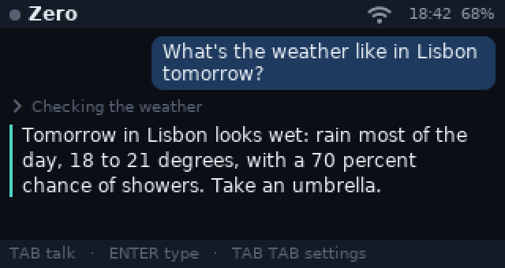
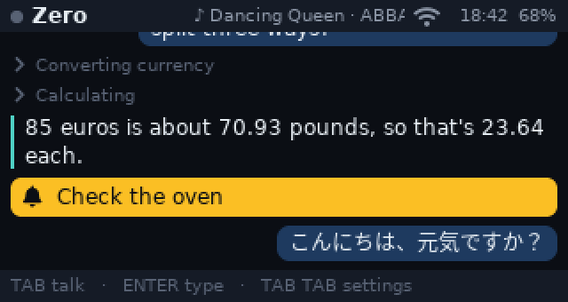
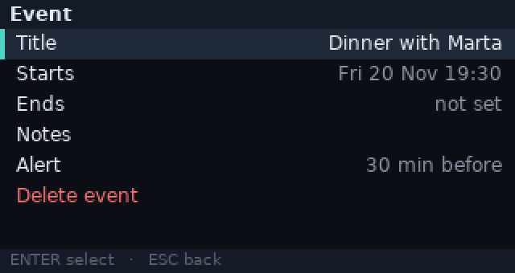

# Zero Bot

A pocket voice assistant for the [M5Stack CardputerZero](https://docs.m5stack.com/en/CardputerZero).
Press a key, talk, and it answers out loud. It can look through the camera, keep your
calendar, set reminders, play your music, work a TV, and look things up, which makes it a handy
travel companion.

It is a native C++ app built on LVGL. It talks to any OpenAI-compatible service that offers
chat with tool calling, speech-to-text and text-to-speech; nothing about a particular provider
is built in.

| | | |
|---|---|---|
|  |  |  |
|  |  |  |

## What it can do

| Ask for | Example |
|---|---|
| Sums | "What's seventeen and a half percent of 2,340?" |
| Python, in a sandbox | "How many days until Christmas?" |
| What the camera sees | "What am I looking at?", "Translate this menu." |
| Calendar | "Put dinner with Marta in my calendar for Friday at eight." |
| Timers and reminders | "Remind me in ten minutes to check the oven." |
| Things to remember | "Remember that I'm allergic to shellfish." |
| Web search | "What time does the Louvre open on Sundays?" |
| Weather | "Do I need an umbrella in Lisbon tomorrow?" |
| Currency | "How much is 85 euros in pounds, split three ways?" |
| Share prices | "How's the Apple share price doing?" |
| Time zones | "What time is it in Tokyo?", "I've just landed in New York." |
| Your music | "Play a random rock song.", "Play something by ABBA." |
| A TV | "Turn on the TV.", "Volume up a bit.", "Channel down." |
| The device itself | "Turn your volume down to 40 percent." |

Weather, currency and share prices use free public services that need no account. Web search
needs a [Tavily](https://tavily.com) key.

## Using it

| Key | What it does |
|---|---|
| **TAB** | Start talking. Press **TAB** again when you have finished. |
| **TAB** twice quickly | Open settings. |
| **ENTER** (or just start typing) | Type a message; **ENTER** sends it. |
| **ESC** | Cancel what is happening: recording, typing, a running request, music. |
| Hold **ESC** | Leave the app and return to the launcher. |
| **fn**+**F** / **fn**+**X** | Scroll the conversation up and down. |

You do not have to wait for it to finish:

- **While it is still working** (thinking, or using a tool), anything you say or type is added
  to the same request, so you can correct or refine it before it answers.
- **While it is speaking**, typing leaves the speech playing; pressing **TAB** stops it at once
  and starts listening.

The dot in the top-left corner shows what it is doing: red while the microphone is live, amber
while it is working, teal while it is speaking. The screen dims after 45 seconds without use
and wakes on any key.

## Install

### 1. Install the package

Download `zero-bot_<version>_arm64.deb` from the Releases page, copy it to the CardputerZero
(over SSH, ADB or the microSD card) and install it on the device:

```sh
sudo apt install ./zero-bot_0.1.0_arm64.deb
```

"Zero Bot" then appears in the launcher within a few seconds. To build the package yourself
instead, see [Building](#building).

### 2. Connect it to an AI service

The app needs the address and key of an OpenAI-compatible service that provides:

- `POST /chat/completions` with streaming and tool calling (a vision-capable model is needed
  for the camera),
- `POST /audio/transcriptions` (speech-to-text),
- `POST /audio/speech` (text-to-speech, returning raw PCM or WAV),
- `GET /models`.

Press **TAB** twice, scroll to *AI service*, and fill in *Address* (ending in `/v1`) and *API
key*. If typing a long key on the small keyboard is a chore, you can instead create
`~/.config/zero-bot/settings.json` on the device over SSH or ADB:

```json
{ "api_base": "https://your-service/v1", "api_key": "your-key" }
```

The first time it connects, the app picks a speech-to-text and a text-to-speech model from the
service's list. You can change every model under *Assistant* in settings.

### 3. Optional extras

- **Web search:** add a Tavily key under *AI service → Web search key*.
- **Music:** copy your music into `~/Music` on the device, then choose *Music library* in
  settings to rescan. MP3 tags (title, artist, album, genre) are read automatically.
- **Home city, your name, time zone:** under *Device* in settings, or just tell the assistant.
- **Start at power-on:** turn on *Device → Start at power-on* to go straight into Zero Bot when
  the device is switched on. Holding **ESC** still returns to the launcher.

## Settings

Press **TAB** twice. Move with **fn**+**F**/**X** (or plain **F**/**X**), change values with
**Z**/**C** (left/right), select with **ENTER**, go back with **ESC**.

| Section | What is there |
|---|---|
| Assistant | Language, vision, speech-to-text and text-to-speech models; voice; spoken replies on/off; fast replies; the assistant's name |
| Device | Volume, brightness, microphone gain, time zone, start at power-on, home city, your name, units |
| Your data | Calendar (edit, add, delete, delete all), reminders, memory (edit, add, delete, forget everything), TV remote, music library, start a new conversation |
| AI service | Address, API key, web search key |
| About | Status and connection test, exit to launcher |

*Fast replies* asks the model to skip its private reasoning step. Answers arrive about a second
sooner per step; turn it off if you find it making mistakes with your model.

 

### TV remote

The remote has built-in codes for Samsung, LG, Sony, Panasonic, Philips, Toshiba and Vizio. Left
on *Any*, it sends each button for every brand in turn, which is usually what you want with a
hotel TV. Point the top edge of the device at the TV.

For anything else, *Your data → TV remote → Learn a button* records a button from the real
remote. Give it a standard name (`power`, `volume_up`, `mute`, `input`, …) to replace the
built-in code, or any name of your own.

## Your data and privacy

- Settings are in `~/.config/zero-bot/settings.json`, readable only by your user. An API key you
  enter is stored there in plain text, so treat the device like anything else that holds a
  password.
- Calendar, reminders, memories and learned remote buttons are plain JSON files in
  `~/.local/share/zero-bot/`. Delete a file to reset that part.
- What you say, type and photograph is sent to the AI service you configured. Web searches go to
  Tavily; weather, currency and share-price lookups go to Open-Meteo, open.er-api.com and Yahoo
  Finance.
- Python runs in a [bubblewrap](https://github.com/containers/bubblewrap) sandbox with no
  network, no access to your files, a 20-second limit and a memory cap.
- Reminders only fire while the app is running.

## Building

Builds have been tested on x86-64 Linux. Everything needed is downloaded into the project
folder; nothing is installed system-wide.

```sh
git clone <this repository> zero_bot && cd zero_bot
scripts/setup-toolchain.sh            # about 2 GB: cross compiler, device sysroot, LVGL, CMake
export PATH="$PWD/.tools/bin:$PATH"
```

### For the device

```sh
cmake --preset cp0 && cmake --build --preset cp0
scripts/package-deb.sh                # writes dist/zero-bot_<version>_arm64.deb
```

With the device attached over USB and ADB enabled (*Settings → Developer → ADB*, USB switch to
the left, cable in the right-hand USB-C port), `scripts/deploy.sh` installs the fresh build
directly. It checks each file's checksum after transfer, because that link has been seen to
corrupt data.

### Desktop simulator

Needs SDL2, FreeType, libpng and libcurl development files from your distribution.

```sh
scripts/setup-toolchain.sh --sim-only
cmake --preset sim && cmake --build --preset sim
build/sim/zero_bot                    # a 3x window; TAB, ENTER and ESC work as on the device
build/sim/zero_bot --shots out/       # render every screen to PNG files
```

### Command-line agent

A screenless build of the agent, for testing prompts and tools quickly:

```sh
cmake --preset cli && cmake --build --preset cli
export ZB_API_BASE=https://your-service/v1 ZB_API_KEY=... ZB_SEARCH_KEY=...
build/cli/zero_bot --ask "what's the weather like in lisbon tomorrow"
build/cli/zero_bot --chat
build/cli/zero_bot --tool weather '{"location":"Lisbon"}'
```

Model names come from `~/.config/zero-bot/settings.json` (`llm_model`, `stt_model`,
`tts_model`). Set `ZB_DRY_RUN=1` to stop tools from playing music or sending infrared.

`tests/agent_eval.py` runs a scored set of requests through this build and reports which tools
were called, whether the answers hold up, and how long each took. See the notes at the top of
the file.

## Troubleshooting

- **"No AI service is set up yet."** Enter an address and key under *AI service* in settings.
- **Voice does nothing, typing works.** No speech models are selected. Choose them under
  *Assistant* in settings.
- **It mishears you.** Raise *Device → Microphone gain*, and speak towards the top of the device.
- **The device cannot see your Wi-Fi network.** The radio is 2.4 GHz only. On some system images
  it also only scans channels 1 to 11, so a router on channel 12 or 13 is invisible; see
  [docs/wifi-channels-12-13.md](docs/wifi-channels-12-13.md) for a fix.
- **The TV does not react.** Aim the top edge at the TV from within a few metres, set the brand
  in settings, or teach it the button from the real remote.
- **Python tool reports the sandbox is unavailable.** Install `bubblewrap`.

## Project layout

```
src/agent/      the conversation loop, prompt, tools, speech queue and service client
src/core/       settings, calendar/reminder/memory store, music library, utilities
src/platform/   display, keyboard, audio, camera, infrared, subprocess helpers
src/ui/         chat screen, menus, settings pages, app controller
src/net/        HTTP client (libcurl)
scripts/        toolchain setup, packaging, deployment
tests/          scored agent test set
packaging/      launcher entry and icon
extras/         device-tree overlay for the Wi-Fi channel fix
third_party/    nlohmann/json (MIT)
```

## Licence

MIT. See [LICENSE](LICENSE). Bundled: [nlohmann/json](https://github.com/nlohmann/json) (MIT).
Built with [LVGL](https://lvgl.io) (MIT).
