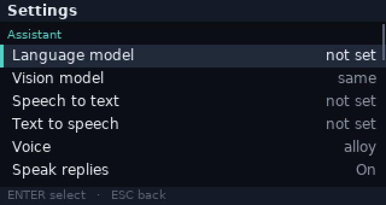
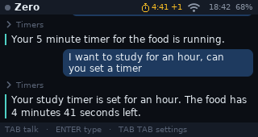
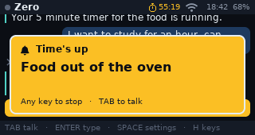
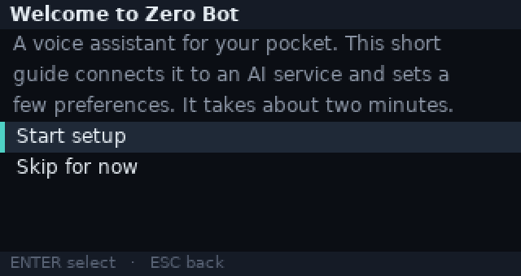
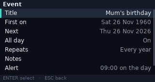

# Zero Bot

A pocket voice assistant for the [M5Stack CardputerZero](https://docs.m5stack.com/en/CardputerZero).
Press a key, talk, and it answers out loud. It can look through the camera, keep your
calendar, run timers, set reminders, play your music, work a TV, and look things up, which makes
it a handy travel companion.

It is a native C++ app built on LVGL. It talks to any OpenAI-compatible service that offers
chat with tool calling, speech-to-text and text-to-speech; nothing about a particular provider
is built in.

| | | |
|---|---|---|
|  |  |  |
|  |  |  |

## What it can do

| Ask for | Example |
|---|---|
| Sums | "What's seventeen and a half percent of 2,340?" |
| Dates | "How many days until Christmas?", "What day is the 3rd of March?" |
| Python, in a sandbox | "Sort these names alphabetically…", longer calculations |
| What the camera sees | "What am I looking at?", "Translate this menu." |
| Calendar | "Put dinner with Marta in my calendar for Friday at eight." |
| Birthdays and repeating events | "Mum's birthday is the 14th of March.", "Bin collection every Tuesday at seven.", "How old will Dad be this year?" |
| Timers | "The food needs to come out of the oven in 5 minutes.", "I want to study for an hour, set a timer.", "How long is left?", "Cancel the study timer." |
| Reminders | "Remind me at 7 tomorrow to call the hotel." |
| Things to remember | "Remember that I'm allergic to shellfish." |
| Web search | "What time does the Louvre open on Sundays?" |
| Weather | "Do I need an umbrella in Lisbon tomorrow?" |
| Currency | "How much is 85 euros in pounds, split three ways?" |
| Share prices | "How's the Apple share price doing?" |
| Time zones | "What time is it in Tokyo?", "I've just landed in New York." |
| Your music | "Play a random rock song.", "Play something by ABBA." |
| A TV | "Turn on the TV.", "Volume up a bit.", "Channel down." |
| Smart-home devices on your own network | "Turn on the bed heater.", "Is the kettle on?", "Switch everything off." |
| The device itself | "Turn your volume down to 40 percent." |

Weather, currency and share prices use free public services that need no account. Web search
needs a [Tavily](https://tavily.com) key.

## Using it

| Key | What it does |
|---|---|
| **TAB** | Start talking. Press **TAB** again when you have finished. |
| **TAB** twice quickly | Open settings. |
| **ENTER** | Start typing a message; **ENTER** again sends it. |
| **del** twice quickly | Start a new conversation: what was said so far is forgotten. Calendar, timers, reminders and saved memories are kept. |
| **ESC** | Cancel what is happening: recording, typing, a running request, music. |
| Hold **ESC** | Leave the app and return to the launcher. |
| **F** / **X** (or **fn**+**F** / **fn**+**X**) | Scroll the conversation up and down. While typing, use **fn**+**F** / **fn**+**X**. |
| **fn**+**S** / **fn**+**D** | Volume down / up. **fn**+**A** mutes and unmutes. |
| **fn**+**U** / **fn**+**I** | Screen brightness down / up. |
| **fn**+**Q** / **fn**+**W** / **fn**+**E** | Music: pause or resume / previous track / next track. |

You do not have to wait for it to finish:

- **While it is still working** (thinking, or using a tool), anything you say or type is added
  to the same request, so you can correct or refine it before it answers.
- **While it is speaking**, typing leaves the speech playing; pressing **TAB** stops it at once
  and starts listening.

The dot in the top-left corner shows what it is doing: red while the microphone is live, amber
while it is working, teal while it is speaking. The screen dims after 45 seconds without use
and wakes on any key.

### Timers

Ask for a timer in your own words, and give it a name if you like: "the food needs to come out
of the oven in 5 minutes", "I want to study for an hour, set a timer". Up to ten can run at
once. The one that ends soonest counts down in the status bar, followed by "+2" when two more
are running (the title of any music playing is shortened to make room), and everything else
keeps working meanwhile: talking, typing, settings, music, the breathing exercise.

- **When one ends** the screen lights up with a banner naming it, an alarm rings for up to a
  minute, music pauses, and the name is spoken once (if spoken replies are on): the alarm holds
  back for a few seconds at most while the assistant speaks, then rings on. If you are talking
  to the assistant at that moment, it waits until you have finished. A timer that ends while
  another is ringing joins the banner and starts the alarm again. **Any key** stops it; **TAB**
  stops it and starts listening, so "give it five more minutes" is one press away.
- **Muted** with **fn**+**A**, the alarm stays silent: the banner is all you get. A key press
  first dismisses the banner, so press **fn**+**A** after that to unmute.
- **Ask** "how long is left?", "add ten minutes to the pasta", "cancel the study timer". With
  several running, it asks which one you mean. *Settings → Your data → Reminders and timers*
  lists them with their time left, to cancel one or all.
- **Timers carry on** if you leave the app. One that ended while it was closed is shown as
  missed when you open it again, and still rings if it ended less than two minutes before.
  While the app is open a timer counts the time that passes, even if the clock is set meanwhile
  (as it can be when the device first goes online after starting).

 

## Install

### 1. Install the package

Download `zero-bot_<version>_arm64.deb` from the Releases page, copy it to the CardputerZero
(over SSH, ADB or the microSD card) and install it on the device:

```sh
sudo apt install ./zero-bot_0.3.0_arm64.deb
```

"Zero Bot" then appears in the launcher within a few seconds. To build the package yourself
instead, see [Building](#building).

### 2. Follow the setup guide

The first time you open Zero Bot it walks you through five short steps: checking the internet
connection, entering the AI service's address and key (with a live test), confirming the models
it found, a few details about you, and optional extras. **ESC** steps back, and you can skip it
and run it again later from *Settings → About → Run the setup guide again*.

 

### 3. What the AI service needs

The app needs the address and key of an OpenAI-compatible service that provides:

- `POST /chat/completions` with streaming and tool calling (a vision-capable model is needed
  for the camera),
- `POST /audio/transcriptions` (speech-to-text),
- `POST /audio/speech` (text-to-speech, returning raw PCM or WAV),
- `GET /models`.

Enter the *Address* (ending in `/v1`) and *API key* in the setup guide, or later under *AI
service* in settings. If typing a long key on the small keyboard is a chore, you can instead
create `~/.config/zero-bot/settings.json` on the device over SSH or ADB before first launch:

```json
{ "api_base": "https://your-service/v1", "api_key": "your-key" }
```

The first time it connects, the app picks a speech-to-text and a text-to-speech model from the
service's list. You can change every model under *Assistant* in settings.

### 4. Optional extras

- **Web search:** add a Tavily key under *AI service → Web search key*.
- **Music:** copy your music into `~/Music` on the device, then choose *Music library* in
  settings to rescan. MP3 tags (title, artist, album, genre) are read automatically.
- **Home city and country, your name, time zone:** under *Device* in settings, or just tell the
  assistant. The country tells apart cities that share a name (London, Canada).
- **Internet through your phone:** pair the phone with the device once in the system Bluetooth
  settings and switch on *Bluetooth tethering* in the phone's hotspot settings. When there is no
  Wi-Fi, Zero Bot then connects through the phone by itself the next time you ask something.
  *Device → Internet via phone* connects or disconnects by hand, and *Use phone when offline*
  turns the automatic behaviour off.
- **Start at power-on:** turn on *Device → Start at power-on* to go straight into Zero Bot when
  the device is switched on. Holding **ESC** still returns to the launcher.

## Settings

Press **TAB** twice. Move with **fn**+**F**/**X** (or plain **F**/**X**), change values with
**Z**/**C** (left/right), select with **ENTER**, go back with **ESC**.

| Section | What is there |
|---|---|
| Assistant | Language, vision, speech-to-text and text-to-speech models; voice; spoken replies on/off; fast replies; the assistant's name |
| Device | Volume, brightness, microphone gain, time zone, start at power-on, internet via phone, microphone, flip camera image, home city and country, your name, date order, units |
| Your data | Calendar (edit, add, delete, delete all), reminders and timers (cancel one or all), memory (edit, add, delete, forget everything), TV remote, smart home (devices by room, setting up, the Tapo account), music library, start a new conversation |
| AI service | Address, API key, web search key, compress audio |
| About | Status and connection test, exit to launcher |

*Compress audio* (under *AI service*, on by default) sends your speech as MP3 and fetches replies
as Opus, roughly a tenth and a fifth of the uncompressed size. In testing it produced the same
transcribed words as uncompressed audio, and on a Bluetooth-tethered phone it cut the time to
send five seconds of speech from about 7 seconds to under 2. If a service does not accept those
formats the app falls back to uncompressed audio by itself.

*Fast replies* (on by default) asks the model to skip its private reasoning step, and makes up
for it by double-checking any reply that did not use a tool before it is spoken. On the bundled
test set this passed 60 of 61 requests at a median of about 3 seconds each on Wi-Fi; with it off
the model reasons on every step, which is a second or two slower.

*Dates* (under *Device*, day first by default) decides how a date given in numbers is read: with
*Day first*, "3/4" is 3 April; with *Month first* it is March 4. The app works this out itself
before the request reaches the model, fills in the year (the next time that date comes round),
and uses the same order when it shows dates and when you type one into the calendar editor. Dates
are always shown and spoken with the month as a word, so a misheard date is easy to catch.

### Calendar

Events can be one-off or repeat every day, week, month or year, and can be timed or all-day.
Ask for them in plain words, or use *Your data → Calendar* to add and edit them by hand (*All
day* and *Repeats* are rows on the event page).

- **Birthdays and anniversaries** are saved as all-day events that repeat every year, and alert
  at 09:00 on the day unless you change the *Alert* row. If you give the year ("born in 1960"),
  the assistant can tell you the age, and the alert includes it.
- **Finding one:** "when is Dad's birthday?" searches the coming year by name.
- A yearly 29 February falls on the 28th in other years; a monthly 31st on the last day of
  shorter months.
- Changing or deleting a repeating event changes the whole series. One-off events have to be in
  the future when you add them by voice.

  

### TV remote

The remote has built-in codes for Samsung, LG, Sony, Panasonic, Philips, Toshiba and Vizio. Left
on *Any*, it sends each button for every brand in turn, which is usually what you want with a
hotel TV. Point the top edge of the device at the TV.

For anything else, *Your data → TV remote → Learn a button* records a button from the real
remote. Give it a standard name (`power`, `volume_up`, `mute`, `input`, …) to replace the
built-in code, or any name of your own.

### Smart home

Zero Bot can switch smart-home devices on your own Wi-Fi or wired network, talking to each
device directly: nothing goes through the makers' cloud services. Supported so far:

- **TP-Link Tapo** smart plugs and power strips (tested against simulated P110 plugs and a P304M
  strip; each socket of a strip is switched on its own).
- **Accessories that work with Apple HomeKit**, over Wi-Fi or Ethernet: one driver for many
  brands, such as hubs and bridges (Hive, tado, Netatmo, ecobee, Aqara, IKEA) and Wi-Fi plugs,
  lights and thermostats that carry a HomeKit setup code. Zero Bot pairs with the accessory
  itself on your network, using the 8-digit setup code from its label, box or maker's app (or the
  text of its QR code); no Apple device, Apple account or internet connection is involved. It can
  switch lights, plugs and switches, dim and colour lights, set heating targets and modes, move
  blinds, set fan speeds, and read temperature, humidity, motion and door or window sensors.
  Locks, garage doors, alarms, cameras, doorbells, valves and taps are never offered, even when a
  bridge has them; televisions, speakers and set-top boxes are left to their own drivers. An
  accessory has only one owner controller, so it is paired either with Zero Bot or with Apple Home,
  not both (*Unpair* in Zero Bot hands it back; do that while the accessory is on and on this
  network, or Zero Bot keeps the pairing and says so). Accessories that use HomeKit only over
  Bluetooth or Thread are not supported. If the handheld is lost while paired, reset the
  accessory's HomeKit pairing from its maker's app. Tested so far only against a simulated
  accessory.
- **Amazon Fire TV** (Fire OS televisions, sticks and cubes; the newer Vega OS sticks are
  untested), worked the way Amazon's Fire TV phone app does: it can move around the menus (up,
  down, left, right, OK, back, home, menu), play and pause, rewind and fast-forward, open an
  installed app by name ("put Netflix on"), switch the screen off and wake the TV again. Volume and
  mute work only on models that report network volume control (many sticks do not); for those,
  and for channels, inputs and number keys, use the infrared remote. A Fire TV in deep standby can
  be woken over the network only if Zero Bot heard its wake-up address while it was on, and then
  takes about 7 seconds to come on; otherwise switching it on needs the infrared remote. Amazon
  does not document this interface, so a Fire TV software update could change it. Tested so far
  only against a simulated TV.

Other families (Hue, Shelly, WiZ, Kasa and more) are added one driver at a time.

1. On your home network, open *Your data → Smart home → Find devices on this network*. Only do
   this on a network you own. The scan only asks devices to identify themselves, the way the
   makers' apps do; it does not log in to anything or change anything.
2. Devices that need it are listed under *To set up*; *Set up…* walks through what the device
   asks for (press a button, accept a prompt, type a code or password). Tapo plugs obey only
   the Tapo account they were set up with, so they ask for its e-mail address and password; once
   typed for one plug, every plug of that account is ready. Only the e-mail and a scrambled form of
   the password are kept on the device, and only one Tapo account: typing another account's
   address replaces it and asks for that account's password before anything is sent. Because a
   plug locks itself after a few wrong passwords, a password a plug has refused is not tried
   again, by any later run either, until you type it again (*Smart home → Tapo account*). A Fire
   TV asks you to turn it on and choose *I have accepted it*; the TV then shows a 4-digit code to
   type, valid for 5 minutes. A code the TV refuses is never sent again: start again and the TV
   shows a new one. A HomeKit accessory asks for its 8-digit setup code (like 123-45-678); a code
   it refuses is not sent again until you type it again, because accessories stop pairing after
   too many wrong codes.
3. What each device controls is then listed by room. On its page you can set the name you will
   say (*Called*), a *Room* (guessed from the name where it starts with one, such as "Bedroom
   lamp"), whether the *Assistant may use it*, and *Ask before switching on*. That last one is on
   by default for anything whose name suggests heat (heater, kettle, iron, …): the assistant then
   asks "Turn on Bed heater?" and switches it only if your very next words are a plain yes ("yes",
   "go ahead", "yes please"). Anything else, including a new request or "leave it off", counts as
   no. Turn it off for something you use every day.

A room's name means the lights in that room. Everything can be switched off at once, but not on.
The assistant also asks first before changing more than eight things at once, before setting
heating above 25 or below 10 °C, at a volume above 70, and when several blinds would move; and it
makes at most 12 changes a minute. Once it has read a web page or looked at a photo, it asks
before every change for as long as that is part of the conversation (start a new conversation,
**del** twice, to end it), so a sign or a page cannot switch anything, and your "no" holds. The
question can be put and answered in everyday words ("Shall I turn everything off?", "yes, the
heater"). These rules are enforced by the app, not left to the model.

Saved devices belong to the network they were found on (its name together with the router's
hardware address). On any other network, and always while the device is online through your
phone (over Bluetooth or a USB cable), the assistant has no smart-home tool at all and no saved
device is contacted; this takes effect the moment the connection changes.
Some makers' local protocols have no password at all; anyone on your Wi-Fi can switch such
devices, with or without this app.

## Your data and privacy

- Settings are in `~/.config/zero-bot/settings.json`, readable only by your user. An API key you
  enter is stored there in plain text, so treat the device like anything else that holds a
  password.
- Calendar, reminders, memories and learned remote buttons are plain JSON files in
  `~/.local/share/zero-bot/`. Delete a file to reset that part.
- Smart-home devices are kept per network in `~/.local/share/zero-bot/smarthome.json`, readable
  only by your user, with what a device needs to be talked to (for Tapo, the account e-mail and a
  SHA-1 of its password). While the assistant may use devices, their names and states are sent
  to your AI service with each request; addresses and account details never are.
- What you say, type and photograph is sent to the AI service you configured. Web searches go to
  Tavily; weather, currency and share-price lookups go to Open-Meteo, open.er-api.com and Yahoo
  Finance.
- Python runs in a [bubblewrap](https://github.com/containers/bubblewrap) sandbox with no
  network, no access to your files, a 20-second limit and a memory cap.
- Reminders and timers only fire while the app is running.

## Building

Builds have been tested on x86-64 Linux. Everything needed is downloaded into the project
folder; nothing is installed system-wide.

```sh
git clone <this repository> zero_bot && cd zero_bot
scripts/setup-toolchain.sh            # about 2 GB: cross compiler, device sysroot, LVGL, CMake
export PATH="$PWD/.tools/bin:$PATH"
```

### For the device

```sh
cmake --preset cp0 && cmake --build --preset cp0
scripts/package-deb.sh                # writes dist/zero-bot_<version>_arm64.deb
```

With the device attached over USB and ADB enabled (*Settings → Developer → ADB*, USB switch to
the left, cable in the right-hand USB-C port), `scripts/deploy.sh` installs the fresh build
directly. It checks each file's checksum after transfer, because that link has been seen to
corrupt data.

### Desktop simulator

Needs SDL2, FreeType, libpng and libcurl development files from your distribution.

```sh
scripts/setup-toolchain.sh --sim-only
cmake --preset sim && cmake --build --preset sim
build/sim/zero_bot                    # a 3x window; TAB, ENTER and ESC work as on the device
build/sim/zero_bot --shots out/       # render every screen to PNG files
```

### Command-line agent

A screenless build of the agent, for testing prompts and tools quickly:

```sh
cmake --preset cli && cmake --build --preset cli
export ZB_API_BASE=https://your-service/v1 ZB_API_KEY=... ZB_SEARCH_KEY=...
build/cli/zero_bot --ask "what's the weather like in lisbon tomorrow"
build/cli/zero_bot --chat
build/cli/zero_bot --tool weather '{"location":"Lisbon"}'
```

Model names come from `~/.config/zero-bot/settings.json` (`llm_model`, `stt_model`,
`tts_model`). Set `ZB_DRY_RUN=1` to stop tools from playing music, sending infrared or switching
smart-home devices. `--home-refresh` reads the smart-home devices saved for the current network.
`ZB_TEST_NETWORK=1` replaces the real network with a stand-in "Test network" on which only
devices at a 127.x address are ever contacted and nothing is scanned; the tests use it.

`tests/agent_eval.py` runs a scored set of requests through this build and reports which tools
were called, whether the answers hold up, and how long each took. See the notes at the top of
the file. `tests/run_unit.sh` builds and runs the tests that need neither a device nor an AI
service (the smart-home layer, and the timers: the timer tool, how timers are stored, the
countdown and the alarm, and the Fire TV and HomeKit drivers), `tests/tapo_e2e.py` runs the
command-line build against two simulated Tapo plugs, `tests/firetv_e2e.py` and
`tests/homekit_e2e.py` run those drivers against a simulated TV and a simulated HomeKit bridge, and
`tests/home_chat_e2e.py` runs its conversation loop against a scripted chat
service to check that a change needing your yes waits for one.

## Troubleshooting

- **"No AI service is set up yet."** Enter an address and key under *AI service* in settings.
- **Voice does nothing, typing works.** No speech models are selected. Choose them under
  *Assistant* in settings.
- **Photos are upside down.** Toggle *Device → Flip camera image* in settings. It is on by
  default, which is right for the CardputerZero's built-in camera.
- **Bluetooth headphones.** Pair them in the system Bluetooth settings and sound (replies and
  music) goes to them. Zero Bot keeps listening through the device's own microphone
  (*Device → Microphone: Built-in*), because a Bluetooth headset can only offer its microphone by
  dropping into phone-call mode, which ruins the sound. If the headphones go quiet or tinny when
  another app records, turn off the system's automatic switch to call mode:
  `wpctl settings --save bluetooth.autoswitch-to-headset-profile false`.
- **It mishears you.** Raise *Device → Microphone gain*, and speak towards the top of the device.
- **The device cannot see your Wi-Fi network.** The radio is 2.4 GHz only. On some system images
  it also only scans channels 1 to 11, so a router on channel 12 or 13 is invisible; see
  [docs/wifi-channels-12-13.md](docs/wifi-channels-12-13.md) for a fix.
- **Slow answers on a phone connection.** Bluetooth tethering uploads at roughly 10 KB/s, and each
  request to the model is 15 KB or more, so expect several extra seconds per step compared with
  Wi-Fi. A Wi-Fi hotspot from the same phone is much faster if the device can see it.
- **The TV does not react.** Aim the top edge at the TV from within a few metres, set the brand
  in settings, or teach it the button from the real remote.
- **A timer ended without a sound.** The device was muted with **fn**+**A** (the banner still
  shows: press any key to dismiss it, then **fn**+**A** to unmute) or the volume is turned
  right down.
- **Python tool reports the sandbox is unavailable.** Install `bubblewrap`.

## Project layout

```
src/agent/      the conversation loop, prompt, tools, speech queue and service client
src/core/       settings, calendar/reminder/timer/memory store, timers, music library, utilities
src/platform/   display, keyboard, audio, camera, infrared, subprocess helpers
src/ui/         chat screen, menus, settings pages, alarm banner, app controller
src/net/        HTTP client (libcurl)
src/smarthome/  device discovery, saved devices and their things, the smart_home tool, drivers
scripts/        toolchain setup, packaging, deployment
tests/          scored agent test set, unit tests (smart home, timers, Fire TV, HomeKit), end-to-end tests with simulated devices
licenses/       third-party notices and the Apache-2.0 text
packaging/      launcher entry and icon
extras/         device-tree overlay for the Wi-Fi channel fix
third_party/    nlohmann/json (MIT)
```

## Licence

MIT. See [LICENSE](LICENSE). Bundled: [nlohmann/json](https://github.com/nlohmann/json) (MIT).
Built with [LVGL](https://lvgl.io) (MIT). The Fire TV driver follows parts of firehose-remote and
hms-firetv (both MIT); the HomeKit driver follows parts of aiohomekit and Apple's HomeKit ADK (both
Apache-2.0). Their notices are in [licenses/THIRD-PARTY-NOTICES.md](licenses/THIRD-PARTY-NOTICES.md),
and the package installs them with the Apache-2.0 text in `/usr/share/doc/zero-bot/`. "HomeKit" is
a trademark of Apple Inc.; Zero Bot is not made or endorsed by Apple or Amazon.
